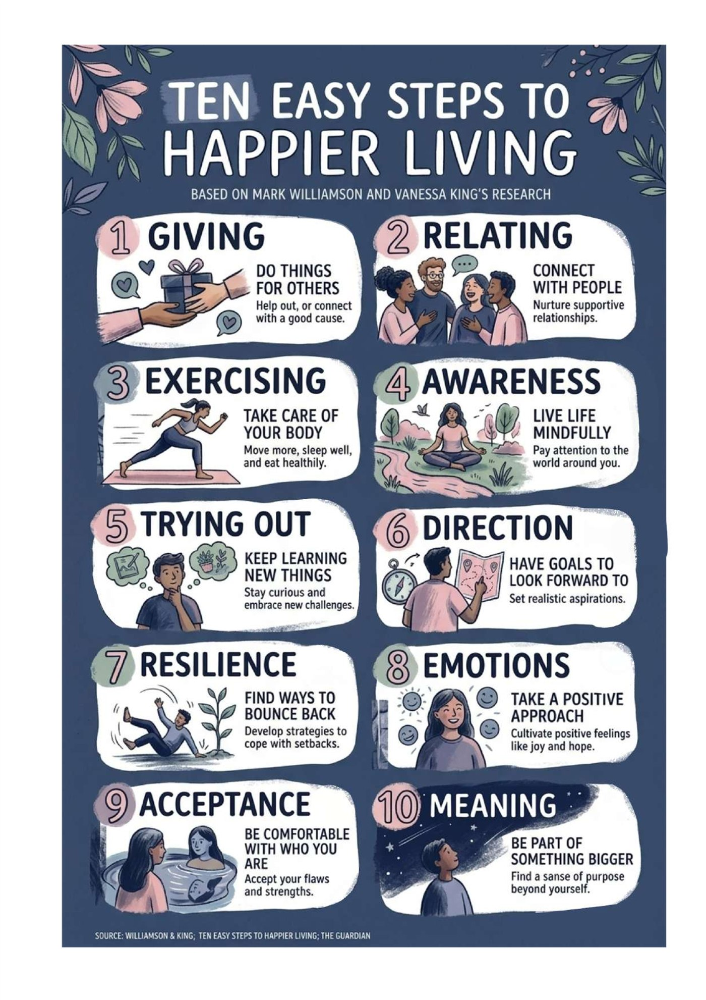
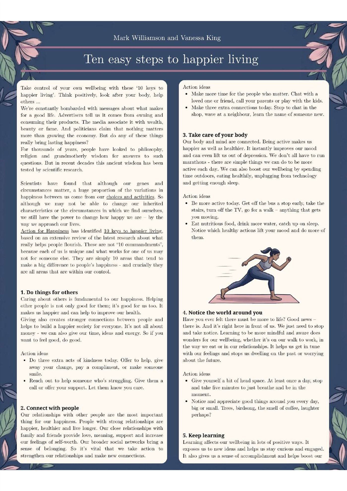
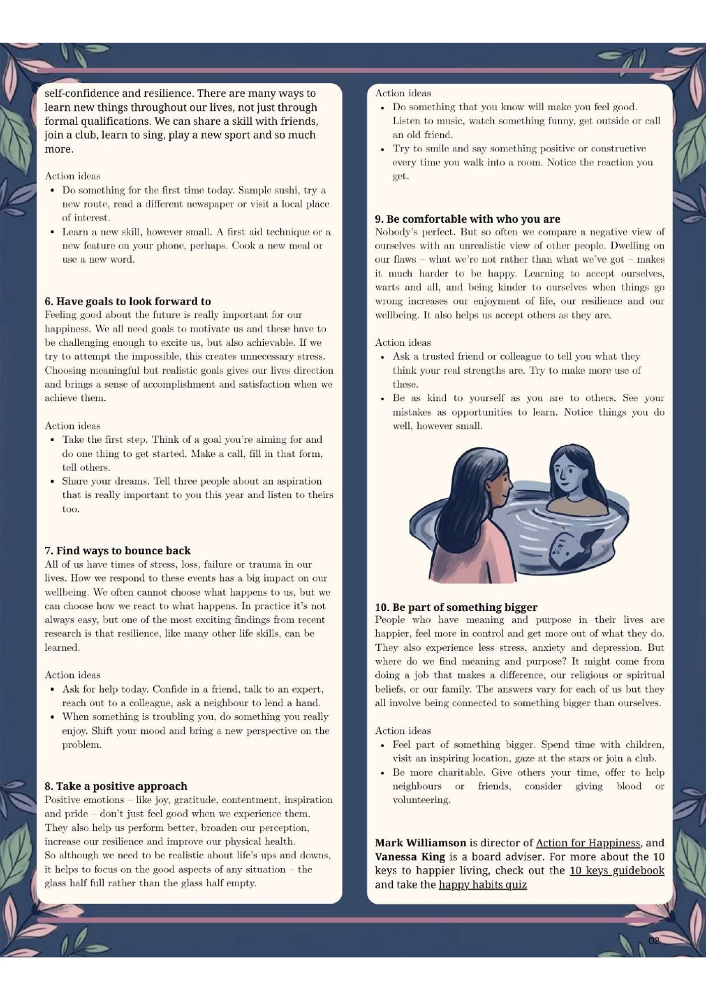
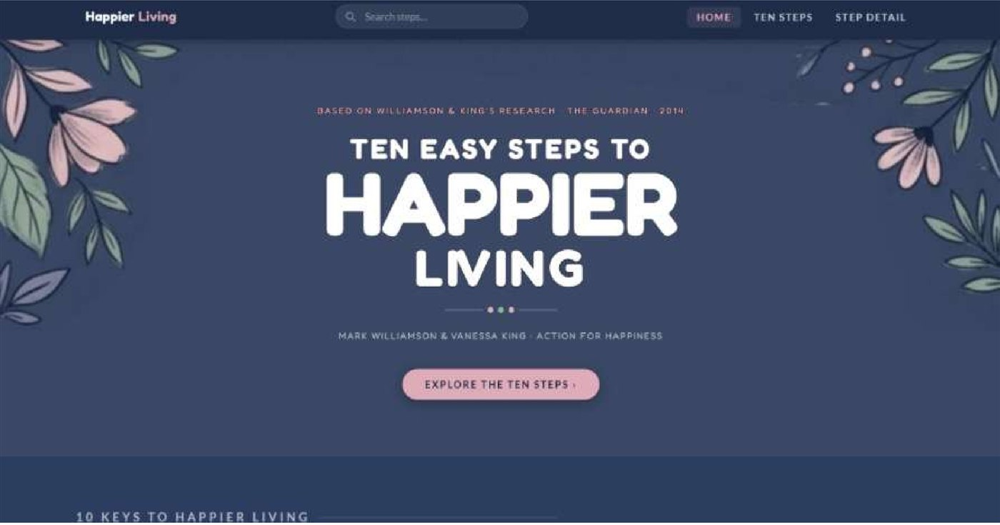
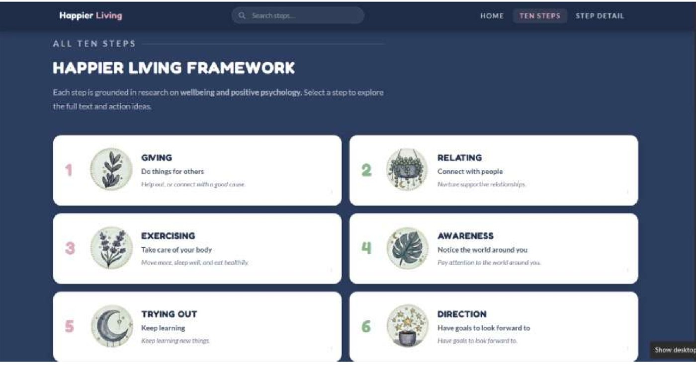
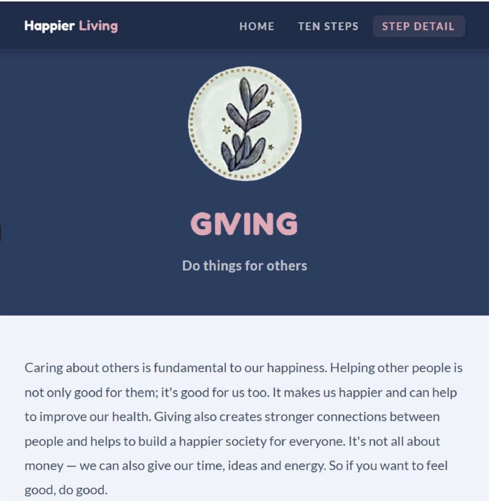
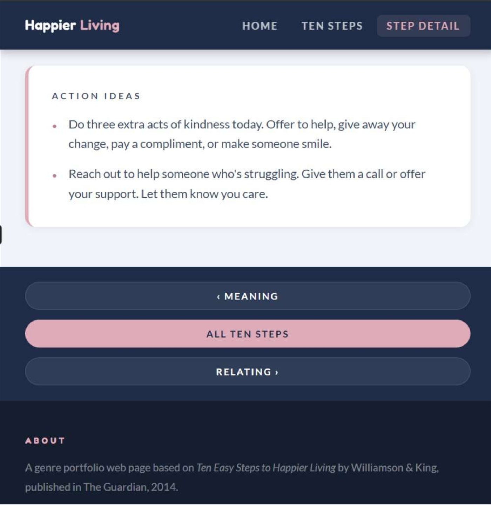

# Happier Living: Genre Portfolio

A group communication project that turns one text, *Ten Easy Steps to Happier Living* by Mark Williamson and Vanessa King (Action for Happiness), into three genres for young adults: an **infographic**, a **two-page magazine spread** and a **three-page website**.

This repository contains **screenshots only**. There is no source code.

## The three genres

| Genre | Audience | Purpose | Where people would see it |
|---|---|---|---|
| **Infographic** | Ages 18-30, active on Instagram and TikTok, prefer visuals to long text | Show all ten steps in one image that can be understood in seconds | Instagram, Pinterest, TikTok; printed in university common rooms, gyms and mental health offices |
| **Magazine** | Ages 18-35 who want something to take home and read later | More detail than the infographic, still quick to read, with text and visuals together | Counselling services, wellness events, student health clinics |
| **Website** | Ages 18-35 who search online for wellbeing tips | Explain each step in depth, with a short version on the home page | A mental health or university wellness site |

## Screenshots

### Infographic

### Magazine (two-page spread)

### Website

## Design decisions

- **One visual identity across all three genres:** navy for a calm, trustworthy tone, soft pink accents and plenty of white space so the topic of mental health feels approachable.
- **Infographic:** ten numbered boxes with an icon and a short label each, so readers can scan in any order.
- **Magazine:** a linear reading path with a clear heading, short paragraph and action ideas for each step; illustrations placed next to the text they relate to.
- **Website:** clear headings and bolded key terms for scanning, easy navigation between steps, and a layout planned for phones.

## Credits

- Source text: Mark Williamson and Vanessa King, "Ten Easy Steps to Happier Living", Action for Happiness. All rights to the original text belong to its authors; this project is coursework.
- Tools: Canva and ChatGPT, as cited in the project's works cited.

## Author

Lea Sherifi - [@leasherifi](https://github.com/leasherifi)
